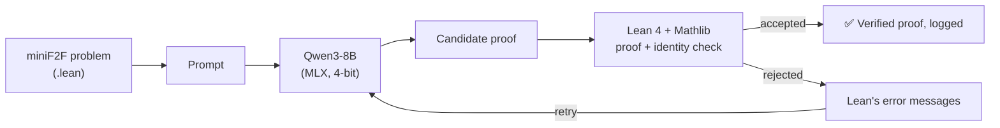

# LEAN_AI: training a small LLM to write machine-checked math proofs

[](https://github.com/educob23/LEAN_AI/actions/workflows/tests.yml)


LLMs write math that *looks* right. In **Lean 4**, a proof is a program, and the compiler
accepts it only if every step is correct. That gives an objective pass/fail signal, which
makes it possible both to **measure** a model honestly and to **train** it.

This project builds that loop end to end on a single laptop (Apple M1 Max) and uses it to
specialize an open-weight model, `Qwen3-8B`, for formal proving. The plan is supervised
fine-tuning, then expert iteration, then reinforcement learning with Lean as the reward.

**Where it stands (Oct 2026):** the pipeline is complete, and the zero-shot baseline is
measured: **17 of the 256 problems in the miniF2F-valid benchmark are solved, every proof
verified by Lean**. That is the "before" number. Next comes the first fine-tune, evaluated
with exactly the same protocol. → [ROADMAP.md](ROADMAP.md)

---

## Highlights

- **End-to-end proving pipeline:** problem parser → LLM generation → Lean verification →
  retries driven by Lean's error messages. Python, MLX and the Lean REPL.
- **Evaluation that can't be gamed.** Each candidate is checked against a trusted copy of
  the theorem statement, so the model cannot score by proving an easier statement under the
  right name. Harness failures and `sorry` placeholders are never counted as passes.
- **Built for long unattended runs:** timeouts, automatic Lean restarts, resumable
  batches, and a log of every attempt. The baseline is ~22 h of unattended compute.
- **Measured, not guessed.** 2,656 logged attempts were analysed to see *why* the model
  fails, and the analysis shapes the training data for the next phase.
- **Tested:** an offline test suite of parser edge cases, proof extraction and the
  soundness checks, run by GitHub Actions on every push.

**Stack:** Python · Lean 4 / Mathlib · MLX & `mlx-lm` (LoRA) · Qwen3-8B · pytest · GitHub Actions

---

## An example

`algebra_sqineq_4bap1lt4bsqpap1sq` from miniF2F, solved on the 4th attempt after Lean's
error messages were fed back to the model. The model's proof, accepted by Lean (comments
removed):

```lean
theorem algebra_sqineq_4bap1lt4bsqpap1sq (a b : ℝ) : 4 * b * (a + 1) ≤ 4 * b ^ 2 + (a + 1) ^ 2 := by
  have : 4 * b * (a + 1) - 4 * b ^ 2 - (a + 1) ^ 2 = -(4 * b^2 - 4*b*(a+1) + (a+1)^2) := by
    ring
  have : 4 * b ^ 2 - 4 * b * (a + 1) + (a + 1) ^ 2 = (2 * b - (a + 1)) ^ 2 := by
    ring
  nlinarith [this]
```

The idea is to complete the square: the right-hand side minus the left-hand side equals
(2b − (a+1))², which is ≥ 0.

---

## How it works



| File | Role |
|---|---|
| [`parser.py`](parser.py) | Splits miniF2F's `.lean` files into individual problems (500/500 parsed correctly). |
| [`wrapper.py`](wrapper.py) | Talks to Lean through the [REPL](https://github.com/leanprover-community/repl). Mathlib is loaded once and reused for every check. Handles timeouts, crashes and restarts. |
| [`retry_loop.py`](retry_loop.py) | One generate → verify step (`attempt`) and the multi-turn retry loop with Lean feedback (`loop`). |
| [`run_batch.py`](run_batch.py) | Unattended, resumable runs over a whole benchmark split. |
| [`scripts/summarize_results.py`](scripts/summarize_results.py) | Turns run logs into the result tables. |

<details>
<summary><b>Design decisions that keep the numbers honest</b></summary>

- **Identity check.** The model's proof is sent together with an `example` built from the
  parser's copy of the statement and closed by `apply <name> <;> assumption`. If the model
  changed the statement, Lean rejects it. (`exact <name>` would look like the obvious
  choice, but it rejects correct proofs of theorems with explicit parameters. Testing caught
  this.)
- **Harness errors are their own outcome.** A Lean REPL failure is never scored as a pass.
  An early version did score it as a pass, and an adversarial
  [design review](docs/design_review_2026_09_20.md) of the pipeline found it.
- **Sampling, not greedy decoding.** The model uses Qwen's recommended sampler. Greedy
  decoding caused the endless repetition seen in early tests.
- **A clean test split.** miniF2F-test is touched once before training and once for the
  final evaluation. All development happens on miniF2F-valid.

</details>

---

## Results: zero-shot baseline

`Qwen3-8B` (4-bit, non-thinking mode), 256 miniF2F-valid problems, 300 s per problem,
retries with Lean feedback.

| | |
|---|---|
| **Solved (Lean-verified)** | **17 / 256 (6.6 %)** |
| Solved on the first attempt | 9 (3.5 %) |
| Extra problems solved thanks to Lean-feedback retries | +8 |
| MATH-level algebra / number theory | 8.5 % / 10.4 % |
| AMC 12 / AIME / IMO | 2.0 % / 0 % / 0 % |

**What the logs say, and why it matters for training:**

1. **Lean's feedback almost doubles the score** (9 → 17 solved), so the retry loop works.
2. **The model knows the format but not the library.** Less than 1 % of answers are
   malformed. But 11 % of proofs use outdated Lean 3 syntax, and 35 % of rejected attempts
   call Mathlib lemmas that don't exist.
3. **So the first fine-tune targets that gap**, with up-to-date Lean 4 / Mathlib proofs
   rather than more prompting.

Full breakdown: [`results/…/SUMMARY.md`](results/2026-10-04_baseline_qwen3-8b_valid_300s/SUMMARY.md).
For context, specialized provers of similar size (DeepSeek-Prover-V2-7B,
Goedel-Prover-V2-8B) score far higher. They show what specialization can achieve.

---

## Roadmap

| Phase | | Status |
|---|---|---|
| **0 · Infrastructure** | Lean toolchain, parser, verification pipeline, sound evaluation | ✅ Aug–Sep 2026 |
| **1 · Baseline → first fine-tune** | Zero-shot baseline ✅ · fix the evaluation protocol (pass@k, seed) · LoRA fine-tune with `mlx-lm` · before/after comparison | 🔄 **now** |
| **2 · Expert iteration** | Retrain on the model's own Lean-verified proofs, round after round | ⏳ |
| **3 · Reinforcement learning** | GRPO with Lean pass/fail as the reward | ⏳ stretch |

Every step, its status and the reasoning behind each decision are in **[ROADMAP.md](ROADMAP.md)**.

<details>
<summary><b>Timeline</b></summary>

| Date | Milestone |
|---|---|
| 2026-08-25 | Scoping: Lean REPL as the verifier, DeepMind miniF2F fork as the benchmark, open-weight model as the target |
| 2026-08-28 | Lean 4 + Mathlib toolchain built; Python ↔ Lean interface working |
| 2026-09-17 | Problem parser complete (500/500); first Qwen3-8B proofs checked by Lean |
| 2026-09-20 | Adversarial design review of the evaluation → soundness fixes |
| 2026-09-21 | Retry loop with Lean feedback, crash recovery, unattended batch runner |
| 2026-10-05 | **Zero-shot baseline complete: 17/256**, plus failure analysis |

</details>

---

## Running it

Requires macOS on Apple Silicon (MLX), [elan](https://github.com/leanprover/elan) and Python ≥ 3.10.

```bash
git clone --recursive https://github.com/educob23/LEAN_AI.git && cd LEAN_AI
(cd miniF2F && lake exe cache get && lake build)      # Mathlib + benchmark
(cd repl_minif2f && lake build)                       # Lean REPL
pip install -r requirements.txt

python run_batch.py --time-budget 300 --results valid_results.jsonl   # resumable
python scripts/summarize_results.py results/<run-dir>
pytest -q tests                                                         # offline, no Lean needed
```

<details>
<summary><b>Repository layout</b></summary>

```
├── parser.py, wrapper.py, retry_loop.py, run_batch.py   the pipeline
├── scripts/        result analysis
├── tests/          offline unit tests, run in CI
├── results/        archived runs: per-problem results, every attempt, summaries
├── docs/           adversarial design review, setup research
├── data/           25-problem dev subset
├── notebooks/      exploration and validation experiments
├── miniF2F/        submodule: benchmark (google-deepmind/miniF2F)
└── repl_minif2f/   submodule: Lean REPL, pinned to Lean v4.27.0
```

</details>

## Limitations

- The baseline uses a **time budget** per problem. The before/after comparison will use a
  fixed number of attempts (pass@k), which is more reproducible.
- miniF2F is public and is probably in Qwen3's training data. This doesn't affect a
  same-model before/after comparison, but absolute scores should be read with that in mind.
- The DeepMind fork's statements differ from the variants most papers report on, so the
  scores are not directly comparable to published ones.

## Use of AI

This project is also how I learned its tools. It is my first time working with Lean 4,
Mathlib, MLX and LLMs running locally. I learned them from scratch with documentation,
papers, forums, and Claude (Anthropic) as a tutor.

**The rule I set myself: I write the core code by hand.** That covers the problem parser,
the Lean interface, the generate → verify → retry loop and the prompts, which are the parts
I want to understand in depth. For these, Claude works as a teacher and code reviewer: it
explains concepts and points out bugs, and I write the fixes.

Where AI added the most value:

- **An adversarial review of the evaluation**, written to try to break my scoring rather
  than confirm it. It found two ways the score could be inflated: a model proving an easier
  statement under the right name, and harness failures counted as passes. I fixed both; see
  the [design review](docs/design_review_2026_09_20.md).
- **Delegated tooling**, so that my time goes to the core. Claude wrote the code around the
  pipeline: the unattended batch runner and the Lean crash recovery, the test suite and CI,
  and the result-analysis script.
- **This README** was structured with Claude's help, so the project stays readable while it
  is still in progress.

---

Built on [miniF2F](https://github.com/google-deepmind/miniF2F) ·
[Lean REPL](https://github.com/leanprover-community/repl) ·
[Mathlib](https://github.com/leanprover-community/mathlib4) ·
[Qwen3](https://github.com/QwenLM/Qwen3) · [MLX](https://github.com/ml-explore/mlx-lm).
Prompt format from DeepSeek-Prover-V2 / Goedel-Prover-V2.

**Eduardo Cobos Fernandez** · [MIT License](LICENSE)
