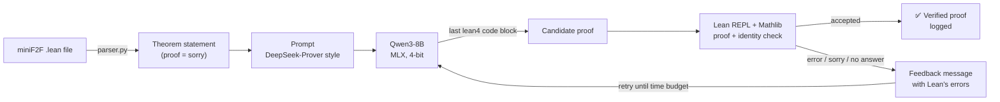

# LEAN_AI — formally verified theorem proving with an open-weight LLM

[](https://github.com/educob23/LEAN_AI/actions/workflows/tests.yml)

-purple)


An LLM writes Lean 4 proofs of competition-math problems, and the Lean compiler checks
them. Every result reported here is **machine-checked**: a proof counts only if Lean
accepts it against the original problem statement.

The goal is to **specialize a small open-weight model for formal proving**, in three steps:
supervised fine-tuning, then expert iteration, then reinforcement learning with Lean as the
reward. All of it runs on one laptop (Apple M1 Max, 32 GB). The headline result will be an
honest *before vs. after training* comparison on the same model and the same protocol.

> **Status (October 2026):** the generate → verify → retry pipeline is complete and
> hardened for long unattended runs. The **zero-shot baseline** of `Qwen3-8B` on the 256
> problems of miniF2F-valid is running now. Fine-tuning starts once that baseline is done.

---

## How it works



| Component | File | What it does |
|---|---|---|
| Problem parser | [`parser.py`](parser.py) | Removes comments, reads the header (`import` / `open scoped`), splits the file into `{name: statement}`. Handles the edge cases found in the real files (dotted names, multi-paragraph docstrings, entries without `sorry`). Checked on all 256 valid and 244 test problems. |
| Lean interface | [`wrapper.py`](wrapper.py) | Runs [leanprover-community/repl](https://github.com/leanprover-community/repl) as a subprocess over JSON. Mathlib is imported **once** per process (~20 s) and every check reuses that environment instead of re-elaborating it. Includes timeouts, crash detection and automatic restart. |
| Generate / verify / retry | [`retry_loop.py`](retry_loop.py) | `attempt()` makes one generation and one Lean check. `loop()` keeps a multi-turn conversation going: on failure, Lean's actual error messages go back to the model. |
| Batch runner | [`run_batch.py`](run_batch.py) | Runs a whole split unattended. It can resume after an interruption, a failure on one theorem never stops the run, and every attempt is logged to JSONL. |
| Analysis | [`scripts/summarize_results.py`](scripts/summarize_results.py) | Turns a run's logs into the tables in [`results/`](results/). |

### Design points that matter for correctness

- **Identity check against the trusted statement.** A model can "succeed" by proving an
  easier statement under the right name, for example `theorem <name> : True := trivial`.
  So each candidate is sent together with an `example` built from the *parser's* copy of
  the statement (never the model's), closed by `apply <name> <;> assumption`. If the model
  changed the statement, this check fails.
  (`exact <name>` would be the obvious choice, but it rejects correct proofs of any theorem
  with explicit parameters. Testing caught this.)
- **Harness errors are never counted as passes.** A REPL-level failure (no `env` in the
  response) is reported as its own outcome. An earlier version scored these as successes.
- **`sorry` and errors are checked separately.** A response with no errors that still
  contains `sorry` is not a proof.
- **Sampling, not greedy decoding.** The sampler uses Qwen's recommended settings. Greedy
  decoding was the measured cause of the degenerate repetition seen in early tests.
- **Every attempt is logged** with the raw model output, the extracted proof, Lean's
  response and the timing. The verified proofs from this baseline become the seed data for
  expert iteration.

---

## Results

### Zero-shot baseline: Qwen3-8B on miniF2F-valid *(run in progress)*

Setup: `mlx-community/Qwen3-8B-4bit`, non-thinking mode, up to 5,000 tokens per attempt,
**300 s of wall-clock budget per theorem**, with retries that feed back Lean's errors.
Problems: the [google-deepmind/miniF2F](https://github.com/google-deepmind/miniF2F) Lean 4
statements (toolchain `v4.27.0`).

| | Value (186 / 256 problems evaluated) |
|---|---|
| **Solved, Lean-verified** | **12 / 186 (6.5 %)** |
| Solved on the first attempt | 7 / 186 (3.8 %) |
| Solved only thanks to error-feedback retries | 5 |
| Model attempts made | 1,885 (median 10 per problem) |

Full breakdown by source, outcome of each attempt and the list of solved problems:
[`results/2026-10-04_baseline_qwen3-8b_valid_300s/SUMMARY.md`](results/2026-10-04_baseline_qwen3-8b_valid_300s/SUMMARY.md).

**What the logs already show.**

- Lean rejects 98 % of attempts, but the model almost always produces a complete,
  well-formed answer: fewer than 1 % of attempts have no extractable proof. The problem is
  proof *quality*, not output format.
- About half of the rejected attempts contain a syntax error. 12 % of all extracted proofs
  use **Lean 3 idioms** (`begin … end`, `∑ x in s`), which current Lean 4 / Mathlib rejects.
  About 38 % call **lemmas that do not exist**. Both are exactly what fine-tuning on
  up-to-date Lean 4 proofs should fix, which makes them a useful baseline to measure against.
- Retries with Lean's feedback almost double the solve count (7 → 12). So the retry loop
  helps, but the base model's Lean knowledge is the real limit.

For scale: specialized open provers in the same size class report much higher
miniF2F-test scores (Goedel-Prover-V2-8B, DeepSeek-Prover-V2-7B). They are a reference
point for what specialization can do, not a target this single-laptop project expects to
match.

---

## Roadmap

- [x] Lean 4 + Mathlib toolchain, REPL interface, miniF2F problem parser
- [x] Generate → verify pipeline with soundness checks (identity check, harness errors, `sorry`)
- [x] Retry loop with Lean error feedback, crash/timeout recovery, resumable unattended runs
- [ ] **Zero-shot baseline on miniF2F-valid (256)**, *running*
- [ ] One-time zero-shot baseline on miniF2F-test, done before any training so the test split stays clean
- [ ] Axiom audit of every accepted proof (`#print axioms`)
- [ ] **Phase 1:** LoRA supervised fine-tuning of Qwen3-8B with `mlx-lm`, then re-evaluation with the same protocol
- [ ] **Phase 2:** expert iteration: attempt problems, keep Lean-verified proofs, retrain, repeat
- [ ] **Phase 3:** reinforcement learning (GRPO-style) with Lean pass/fail as the reward

---

## Repository layout

```
├── parser.py              miniF2F .lean file → {theorem name: statement}
├── wrapper.py             Lean REPL subprocess: send / check / timeout / restart
├── retry_loop.py          prompt, extract_proof, attempt, loop
├── run_batch.py           unattended, resumable batch over a split
├── scripts/               result analysis
├── tests/                 offline unit tests (no Lean or model needed), run in CI
├── results/               archived runs: per-theorem results, per-attempt logs, summaries
├── data/                  dev_subset_25.json, a hand-picked set for quick iteration
├── docs/                  design notes, adversarial design review, roadmap, changelog
├── notebooks/             exploration and one-off validation experiments
├── miniF2F/               submodule: google-deepmind/miniF2F (problems, Lean project)
└── repl_minif2f/          submodule: leanprover-community/repl, pinned to Lean v4.27.0
```

## Running it

Requirements: macOS on Apple Silicon (MLX), [elan](https://github.com/leanprover/elan),
and Python ≥ 3.10.

```bash
git clone --recursive https://github.com/educob23/LEAN_AI.git
cd LEAN_AI

# Lean side: fetch the Mathlib cache and build the problem imports, then build the REPL
(cd miniF2F && lake exe cache get && lake build)
(cd repl_minif2f && lake build)

# Python side
pip install -r requirements.txt

# Unattended run over miniF2F-valid (resumable: re-running skips finished theorems)
python run_batch.py --time-budget 300 --results valid_results.jsonl --attempts-log attempts.jsonl

# Summarize a run
python scripts/summarize_results.py results/<run-dir>

# Offline unit tests
pytest -q tests
```

The model (`mlx-community/Qwen3-8B-4bit`, about 4.6 GB) is downloaded on first use.

## Limitations

- **Time budget, not pass@k.** The stopping rule is wall-clock time per theorem, so the
  number of attempts depends on generation speed. Before the before/after comparison, the
  protocol will move to a fixed number of attempts (pass@k), with time kept only as a cap.
- **Possible contamination.** miniF2F is public and is probably in Qwen3's pretraining
  data. This does not invalidate a same-model before/after comparison, but absolute numbers
  should be read with that in mind.
- **Benchmark variant.** The DeepMind fork's statements differ from the miniF2F variants
  that most published provers report on, so the numbers are not directly comparable.
- **No axiom audit yet.** The 12 accepted proofs contain no `sorry`, `axiom` or
  `native_decide`. A systematic `#print axioms` check on every success is on the roadmap.

## How this project is built

I write the core logic myself: the parser, the Lean interface, the retry loop and the
prompting. I used Claude (Anthropic) as a reviewer throughout, and it wrote parts of the
reliability infrastructure (the batch runner and the REPL crash recovery). The design
history, including an [adversarial design review](docs/design_review_2026_09_20.md) of the
evaluation's soundness, is in [`docs/`](docs/).

## Acknowledgements

[miniF2F](https://github.com/google-deepmind/miniF2F) (Google DeepMind fork) ·
[Lean REPL](https://github.com/leanprover-community/repl) ·
[Mathlib](https://github.com/leanprover-community/mathlib4) ·
[Qwen3](https://github.com/QwenLM/Qwen3) ·
[MLX / mlx-lm](https://github.com/ml-explore/mlx-lm).
The prompt format follows the one published with DeepSeek-Prover-V2 and Goedel-Prover-V2.

---

*Eduardo Cobos Fernandez* · [MIT License](LICENSE)
